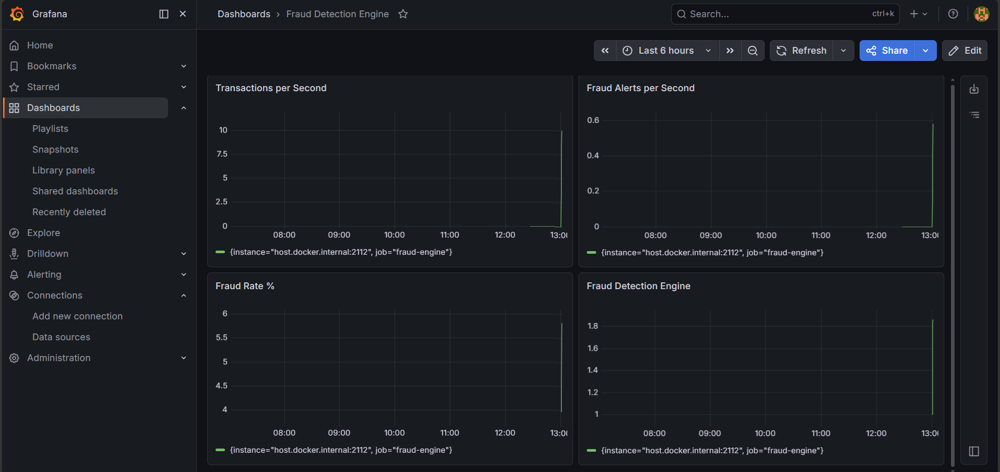

# Real-Time Fraud Detection Engine

[](https://github.com/adhi2801/fraud-detection-engine/actions/workflows/ci.yml)

A card-fraud detection system with two parts:
- a **streaming pipeline in Go**: transactions flow through Redpanda, Redis keeps one-hour sliding-window features per
  card, and every transaction gets a score, a decision and the reasons behind it, with Prometheus and Grafana for
  monitoring;
- an **XGBoost model** trained on 284,807 real card transactions, exported to ONNX and served behind a REST API with a
  small web UI.

Each decision combines a base score (the model, or behavioural rules when the model can't be used, see below) with a
per-card behavioural anomaly score and a fraud-ring signal (many cards hitting one merchant). The result is compared
with an adaptive, per-card threshold.



## How good is the model?

Measured by [`evaluate_model.py`](evaluate_model.py) on the 20 % test split that
[`train_model.py`](train_model.py) holds out (56,962 transactions, 98 of them fraud, so 0.17 %). Results are in
[`results/model_eval.json`](results/model_eval.json), with bootstrap 95 % confidence intervals.

| Metric | Value |
|---|---|
| ROC-AUC | 0.981 (0.963 – 0.995) |
| PR-AUC (a random model scores 0.0017) | 0.882 (0.821 – 0.935) |
| Precision at threshold 0.5 | 0.871 (0.804 – 0.933) |
| Recall at threshold 0.5 | 0.827 (0.745 – 0.898) |
| Frauds caught / missed | 81 / 17 |
| False alarms | 12, about 2 per 10,000 legitimate transactions |

With only 0.17 % fraud, ROC-AUC flatters almost any model, so PR-AUC and precision/recall are the numbers to look at.
One caveat: there is no separate validation split, and the model settings were chosen while looking at this test
split, so the numbers may be slightly optimistic.

## How live requests are scored, and the main limitation

The model was trained on the bank's 28 anonymised PCA features (V1–V28) plus amount and time. A live request that only
has a card, amount, merchant and country does not contain those features, and they can't be computed from it. So:

- **with `bank_features`** (V1–V28), the API scores the request with the model (`"score_source": "model"`);
- **without them**, it uses behavioural rules on amount, geography, velocity and hourly spend (`"score_source": "rules"`),
  the same rules the Go pipeline falls back to.

An earlier version filled V1–V6 with velocity and spend values and set the rest to zero. The model was never trained on
inputs like that, so those scores did not mean anything. That is fixed now, and the response always says which scorer
was used. The streaming demo's producer generates synthetic transactions without bank features, so the Go pipeline runs
on the rules. Its inference server now answers those requests with HTTP 422, and the scorer falls back deliberately
instead of failing silently.

To use a model on live traffic, the next step is to train one on features the service can compute itself (velocity,
spend, merchant diversity, geography, time of day) with a dataset that has card-level history, such as IEEE-CIS.

## Try it

```bash
pip install -r requirements.txt
python app.py                 # API and web UI on http://localhost:8888, UI at /ui
```

The UI's **"Replay a real fraud / legit payment"** buttons send real transactions from the held-out test split
([`samples/heldout_transactions.json`](samples/heldout_transactions.json), 10 frauds and 10 legitimate payments, never
used for training) through the model. It catches 9 of the 10 frauds. `test-119714` is a genuine miss, and none of the 10
legitimate payments is flagged.

```bash
# behavioural rules (no bank features)
curl -X POST localhost:8888/evaluate -H "Content-Type: application/json" \
  -d '{"card_id":"card-42","amount_usd":1800,"merchant_id":"merch-001","country_code":"RU"}'

# the model, on a real held-out transaction: take one from GET /samples and send its fields
curl localhost:8888/samples
```

The API was deployed on Railway; that deployment is currently offline.

## Streaming pipeline (Go)

1. The producer generates synthetic card transactions.
2. Redpanda streams them across 6 partitions.
3. The detection service consumes each one and updates Redis sliding-window features for the card (count, spend and
   distinct merchants in the last hour, international flag).
4. Each transaction is scored and published to the `fraud-alerts` topic when it is flagged.
5. Prometheus collects metrics and Grafana shows them live.

Install Go 1.21+ and Docker Desktop, then:

    docker compose up -d
    docker exec fraud-engine-redpanda-1 rpk topic create transactions --brokers localhost:9092 --partitions 6 --replicas 1
    docker exec fraud-engine-redpanda-1 rpk topic create fraud-alerts --brokers localhost:9092 --partitions 2 --replicas 1
    python inference_server.py        # model server on :8888
    go run detection/main.go          # detection service, metrics on :2112
    go run api/main.go                # REST API on :8090
    go run producer/main.go           # synthetic traffic

`start.ps1` starts all of this on Windows. Grafana: http://localhost:3000, Redpanda Console: http://localhost:8080.

## Load test

`loadtest.py` sent 1,000 synthetic transactions with 20 concurrent clients to the Go REST API running locally:

| Metric | Result |
|---|---|
| Throughput | 480 requests/second |
| Latency P50 / P95 / P99 | 35 / 93 / 140 ms |
| Errors | 0 % |
| Share of requests flagged | 3.8 % (the generator makes about 5 % suspicious-looking transactions) |

These are end-to-end times, including queueing across 20 concurrent clients. The API also reports its own processing
time per request in `latency_ms`. They were measured with the earlier version of the scorer.

## Tests

`pytest -q` checks which scorer is used, replays the 20 real held-out transactions, and checks input validation.
CI also builds and vets the Go code.

## Tech stack

| Technology | Purpose |
|---|---|
| Go | Producer, detection service and REST API |
| Redpanda | Kafka-compatible event streaming |
| Redis | Sliding-window feature store |
| XGBoost + ONNX Runtime | Model training and serving |
| Flask | Python API and web UI |
| Prometheus + Grafana | Metrics and dashboards |
| Docker | Local infrastructure |

## Data

Model training uses the [Credit Card Fraud Detection dataset](https://www.kaggle.com/datasets/mlg-ulb/creditcardfraud)
from the ULB Machine Learning Group (Open Database License). Put `creditcard.csv` in `data/` to retrain
(`python train_model.py`) or re-evaluate (`python evaluate_model.py`). Only the 20 sample transactions are included
in this repo.

## Author

Adhiswauran V, B.Tech Computer Science (AI & ML)
